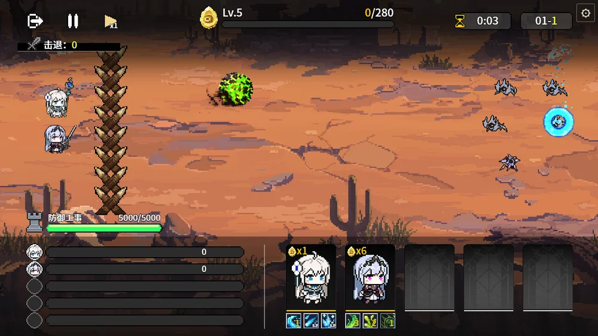

# 魔物抵御战 Web

《星落》活动小游戏「魔物抵御战」的独立网页版。浏览器在本地运行原版 Lua 战斗与 FairyGUI 窗口，保留出怪、角色技能、升级选择和结算规则。支持鼠标和触屏。

**[正式游玩](https://fallstar.online/)** · [测试版](https://luckyking232.github.io/starfall-monster-defense-web/play/) · [下载正式版](https://github.com/luckyking232/starfall-monster-defense-web/releases/latest)



## 怎么玩

在活动主页按「前往」，拖动地图并点击关卡牌面。守住防御工事，积累经验后从原技能卡中选择强化。共有 20 个普通关和 1 个循环关。首次启动会加载引擎、游戏脚本和界面图集，进度条显示当前阶段。

右上齿轮可调整音乐与音效、显示帧率，以及创建、改名、切换或删除本地存档。音效滑杆 100% 对应原始音量的十分之一，音乐可独立调整。进度保存在当前浏览器与网站地址下。调试页可输入 `ALLSTAGES` 开放当前档的关卡和随关角色，或在战斗中输入 `LEVELUP` 进入原版升级流程。主页有三个可以互动的彩蛋。

## 在自己的电脑运行

下载 Release 附件 `MonsterDefense-v1.0.1.zip`，解压后在含有 `index.html` 的目录启动一个静态服务器。

```sh
python -m http.server 8080 --bind 127.0.0.1
```

用浏览器访问 `http://127.0.0.1:8080/`。WebAssembly、Worker 和资源校验需要 HTTP 的 localhost 或 HTTPS。再次使用同一浏览器与地址即可继续存档。

## 开发

使用 Node.js 22.12 或更新版本。仓库含正式版运行所需的已准备资源。从仓库根目录执行以下命令。

```sh
cd apps/game
npm ci
npm run build
npm run preview
```

默认预览地址为 `http://127.0.0.1:4173/`。[工程结构与测试](docs/development.md) · [运行素材与授权](docs/assets.md) · [版本记录](CHANGELOG.md)。
