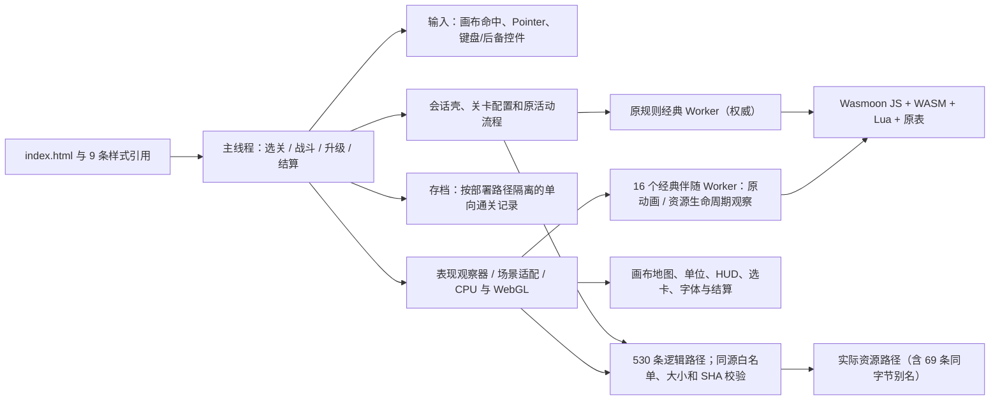

# 正式工程重构：运行基线、依赖与迁移约束

基线：`74625a1bbca5e1c34495713e8c9ce23737bb3dd5`（快照分支 `baseline/product-refactor-20261125`）。施工分支 `refactor/product-engine`。Alpha Tag、原 Release ZIP、线上 `/play/` 和 `/qa/startup/` 都不是新工程的写入目标。这里的“正式工程”指新的源码与发布流程，不表示原版已完整复刻或游戏已发售。

## 从哪个入口开始

- 站点根 `apps/pages/index.html` 是说明页。公开固定 Alpha 实际游戏入口为 `/play/index.html`，它从锁定 ZIP 挂载。
- 当前 QA 入口 `/qa/startup/index.html` 基于同一份 Alpha，但已有选关首屏、时钟背压和冻结生命周期修正。迁移保留这些已验证的行为。未上线的快速确认候选不能算基线的一部分。
- 路由兼容器有三个不同用途：同源边界、逻辑路径映射、哈希验证。三者必须保留等效边界，但不要求继续使用旧目录做物理部署。



## 机器审计

从读取过、逐文件核验的 Alpha 和 QA 生成同构报告：

```sh
python3 scripts/audit_runtime.py /path/to/extracted/alpha --repo . --out /tmp/alpha-audit.json
python3 scripts/audit_runtime.py /path/to/verified/qa --repo . --out /tmp/qa-audit.json
```

两个基线各 469 个物理文件（分别 31,800,721 和 31,803,367 字节），包括一个入口、10 个 CSS、176 个 MJS、22 个 JS、64 个 Lua、98 个 PNG、一个 OTF 和一个 WASM。已逐条核对运行时路由表和 17 个经典 Worker 的物理文件。该命令输出逐文件哈希、所有解析出的字面量引用边（Alpha 1,308；QA 1,310）、计算路径调用行、工作线程入口、合并别名与重复组。它**不是** JavaScript/Lua 全路径解释器；201 个文件落入入口字面量闭包，剩余 268 个**不得**认定未用。JSON 内的路径、计算性 URL、Lua `require`/表和关卡分支必须进一步验证。Alpha 与 QA 文件列表相同，变更只触及入口、账本、清单和五个表现/交互模块；权威 Worker 和原 Lua/WASM 字节未变。

| 类别 | 现状 | 迁移决策 |
|---|---|---|
| 正式游戏启动与运转 | 唯一启用的 `cloud-temporary-20108-cpu/ui.mjs`、`site/session.mjs`、`site/shell.mjs` | `index.html` → `src/app/`；壳与画面职责拆至 `src/scenes/`、`src/ui/` |
| 权威/伴随 Worker | `_portable/authority.js`、`qualified-game/revisions/r6/worker.js`、各伴随脚本 | `src/engine/` 与 `src/battle/`；协议与 Lua 行为不改，伴随观察不能反写权威 |
| 生命周期与内容 | `activity-flow/`、`profiles.mjs`、`art-profile.mjs`、已生效地图和素材适配器 | `src/core/`、`src/scenes/` 与 `assets/config/`；特殊特效按能力注册，不复制主循环 |
| 表现及暂时修正 | 启用的 site-layer、actor-bridge、presentation-clock、各观察和画布适配器；启动、背压、冻结补丁 | `src/rendering/`，把验证门槛留在测试侧；描述性能力名称替代阶段名。已经验证的修正变为源码而非对产物打补丁 |
| UI、输入、存档、平台传输 | `hud-*`、`screen-shell/`、pointer-priority、`_portable/progress-store.mjs`、`portable.mjs` | `src/ui/`、`src/input/`、`src/storage/`、`src/platform/` 和 `src/assets/` |
| 原始内容／依赖 | 路由中 Lua、合成数据、PNG、OTF、WASM、Wasmoon | `assets/{images,animations,audio,fonts,config,lua}` 和 `vendor/`；保留字节、来源、许可及路由键 |
| 验证、诊断与构建 | 规则夹具、参考回放、断言、发布版本配方和旧 Pages 组装 | `tests/`、`docs/`、`scripts/`，不进新游戏 ZIP。QA 与旧 Alpha 通过基线快照与固定 Release 独立复现 |
| 历史、不活跃候选 | 只当过旧入口的 UI、旧显示层以及未证明会被访问的素材 | 先记录，比较行为，再使图断开；可证明不影响动态路径后使用 Git 历史留档，不建立大 legacy 目录 |

### 重复与近似重复

QA 中 `ui` 有 19 份、13 种字节，入口只挑一份；`site-layer` 有 18 份、均不相同，只有一份是当前入口实现。单靠相似度不能选“最新”替代。物理文件共有 9 组重复：4 组 UI（2/3/2/3 份）、2 组场景配置（4/2 份）、1 组 canonical-attachment（6 份）、1 组 actor-bridge（6 份）、1 组时钟（6 份）。路径清单由机器审计输出。规则资源的 69 条别名不是 69 份额外物理文件。

- **actor-bridge 与 presentation-clock**：各 8 份、3 种字节，全部进入字面闭包。六份相同文件只可在其相对依赖解析及常量、协议一致后合并，不能仅以两个文件本身哈希相同为据。早期 /1 与召唤 /2 不是同一种协议。
- **site-layer / observer**：首关冻结修正延用严格的特效生命周期判定；中段召唤和后段死亡事件另有适配。7 个 observer 均可进入字面闭包，不能一律删除或以“忽略异常”替代。先统一调度和身份检查，保留各自的真实事件消费。
- **canonical-attachment**：六份字节相同，未由当前入口直接进入字面闭包；还要排除动态查表与预检引用，才可退出正式构建。
- **UI**：旧 UI 与当前启动 UI 的核心差异包括直接进入选关、按运行时压力推迟下一次自动推进、输入队列承接与错误状态处理；阶段迁移不可把行为退回到标题页或无控制地推进多批规则帧。

## 验收与风险

1. 先固定原 Lua/WASM、Worker 协议、同种子同操作快照和一次完整真实浏览器路径。布局、呈现和日常构建可以重新设计，玩法数据不可改动。
2. 新显示调度采用有序、不可合并的生命周期事件流，以及可合并的绘制目标。每次提交绑定关卡、对局、世代及画布，落后/跨场景的任务不能覆盖新画面。最近有效帧必须独立于临时画布和原 Worker 的进度；恢复后重建纹理与 GPU 状态。没有首帧或不可恢复故障时显示明确状态。
3. 旧版按部署路径隔离存档。改物理入口或目录不会自动沿用旧部署路径的记录。不得修改或覆盖旧键；同源跨路径迁移必须明确旧键合法性、损坏、配额、并发和回退，验收后再开。
4. 新构建只使用当前源码和锁定的资源输入，不能读取已经发出去的 Alpha 作日常游戏本体。两平台共享静态输出；TapTap 打包仅做自检，绝不自动上传。
5. 已复核官方 [游戏工具上传 Skill v1.0.0](https://3rd-tool-h5-al.tapimg.com/temp/taptap-game-tool-upload-1_0_0.zip)，原包 SHA-256 `87bd192f6a1175ba26ec7479617b23e67d69145e6167a607f2e9ddf315b16883`。一层包装目录、直属入口、300 MiB 快照上限与相对路径是检查基线，不等同于账号当前的上传页或两端真实 WebView 测试。
6. 原生弹道、部分粒子、音频混音及 HUD、真实 App/WebView 和所有关卡未验收；本重构不宣告这些内容完成。

## 里程碑：仓库根入口可启动

需要 Python 3.10+ 和 Node.js；不需要 npm 依赖。可选 `STARFALL_INPUTS`（或 `--inputs`）指向锁定的 **source-inputs** ZIP；不传时从固定 Release 地址下载并逐项校验。**不读取可玩 Alpha ZIP。**

```sh
npm run dev -- --port 8000
npm test
npm run build
npm run preview -- --prefix /qa/build/
```

`index.html` 和 `src/app/game.mjs` 已为实际源入口。四个连续画面／冻结桥接文件已从产物补丁变成可编辑源文件；过渡适配器仍将它们投影到剩余运行时能够解析的旧相对路径。不凭此认定模块合并完成，也不将该构建用于正式部署。构建只写未存在的输出目录；`dist/` 和旧 Alpha 不纳入这次改动。

实测（桌面 Chrome，迁移后第一次构建）：显示原选关地图，同一路径读到既有第 1 关通关记录，进入第 2 关，原地图与单位可见；暂停和继续响应，第 300 帧 3 击杀，升级选卡并确认回到第 300 帧战斗。**已复现选卡刚入场战场黑屏**，不是这次入口迁移完成就已解决。整局新构建回归、移动端与 TapTap 仍待测。

## 里程碑：Canvas2D 最近有效帧

Canvas2D 的阶段适配器只写不可见的完整帧，单一前台 Canvas 一次提交完整像素。按关卡、对局和世代阻止旧帧覆盖；没有新画面时不清屏，选卡、暂停、退出确认和结算等待都可保留本局最近一帧。超过同步窗口或观察出错有明确提示，旧画面不冒充最新规则帧。显示目标丢失后清除其有效标记，恢复事件后只准新的完整帧进入。原规则请求、生命周期事件、原素材和存档保持不变。

桌面 Chrome 复测第 2 关同一条路径：第 300 帧、3 击杀。前一提交在升级入场显示黑底，新提交保留原地图与单位，原卡片随后叠在实际战场上；点击选卡确认后可暂停，战场和敌人仍可见。合成测试另验脏帧、慢帧、切局、失败和 Canvas2D 恢复，**不宣称真机 GPU 失效测试、所有关卡和 WebGL 已通过**。本节 Canvas2D 验收时 WebGL 尚未接入，后续迁移见下文；仍须解耦生命周期观察和可合并显示任务，并隔离导致观察链停止的未完成画面。

## 里程碑：共享角色桥接与动画时钟

原来 6 份相同的角色桥接和 6 份相同的动画时钟现各只有 1 份实现，放在 `src/rendering/actors/`。旧路径暂时只绑定各自原来的 `SCENES`；不归并配置或改协议。六套配置实际上有五种字节。构建先核对旧实现的完整 SHA，再产生只做注入和再导出的适配层。其他两种桥接与时钟不在这次合并内。

用 `node tests/product-actor-bindings.mjs VERIFIED_QA BUILT_PRODUCT` 对照迁移前后：60 个真实场景绑定、120 次桥接/时钟成功打开、60 次错素材摘要拒绝结果一致。该测试覆盖加载和校验，不替代对应关卡战斗全程或逐帧比对。

## 构建及包体检查的边界

`npm run package -- --manifest PATH --out GAME.zip` 从同一个 `dist/` 取输入；仍须逐文件授权、来源、字节和 SHA，未经审核不产生正式包。`npm run check:zip -- GAME.zip` 是严格的本地只读预检。本轮用临时 ZIP 跑预检，历史如下：50 条绝对路径样式的 JS 引用被拒，另有计算路径告警。这里有经过旧虚拟路由器重映射的路径，必须逐条区分真实资源引用和逻辑标识，不能仅因桌面可运行就取消拦截。产品构建、历史固定 Alpha 和本地 WebView/真机结果分别报告；未上传 TapTap，也未替换现有 Pages。

CI 的产品任务先从当前源码和固定资源输入构建，之后才读取原 Alpha，仅用作对照测试。对照锁住权威 Worker、存档和全部 Lua/WASM 字节，不替代同输入、同操作的完整规则回放。

### 资源物理路径第一批

产品构建将 27 个规则 Lua 文件移到 `assets/lua/{battle,combat,choice}/`，Wasmoon JS / WASM 移到 `vendor/wasmoon/`。没有物理重复副本；所有遗留逻辑路径和别名继续指向同一份已锁定字节。经典规则 Worker、进度存储、其他 Lua/WASM 完整性一同对照旧 QA，69 项全部一致。尚不把生成路由或历史装配称为已消除。

桌面 Chrome 在三层子路径启动新构建，完成选关、第一关原规则推进（300 帧、3 击杀）及第 301 帧选卡显示；可见原地图和保留战场。此记录只涵盖桌面 Chrome 的 Canvas2D 路线，不是 TapTap WebView 验收或全关卡验证。

CI 还从当前构建的三层子路径启动真正的经典规则 Worker 和观察 Worker，在 Node 中执行原 Lua/Wasm。固定输入回放 11 次选卡、两波、205 击杀、第 4181 帧自然获胜并写入一个通关存档标记。命令为 `node tests/product-stage1-replay.mjs dist`。Canvas 目标在这个测试中被替身记录；不要将此测试当成浏览器或 WebView 验收。

### 分享链接与 Alpha 存档兼容

产品版从同一 origin 和同一挂载路径的目录入口或 `index.html` 读写原有保存键。两个入口 URL 上的查询参数和片段不再导致已有存档被当成仅当前会话。只放宽入口文档，不放宽资源或 Worker 请求，也不接收不合格的路径、带查询的挂载基址或其他 origin。没有跨挂载复制；日后若切换正式入口，发布方案必须保持挂载路径，或另行验证迁移。QA 保持独立。旧 Alpha 源和制品不动。

Chrome 本地隔离夹具用原格式写入虚拟的第一关存档，同一存档字节只读验证。旧 Alpha 的干净入口可见通关，带分享参数和片段时暂时看不到；产品的两个干净入口及分享入口均读到，实际点开了第二关。QA 没有带入存档。Android WebView 实机保存和重启检查仍未执行。

### WebGL 暂存与可见战场

WebGL 绘制改为只写不可见画布。一次世界绘制成功、对应观察操作完整返回，并且关卡／对局／请求与当前会话一致后，才整体覆盖独立的 Canvas2D 前台。复制不是增量合成，透明像素也会替换；GPU 没有新确认画面时，升级、暂停和短期故障继续显示本局最近有效帧。局部 HUD 仍只凭精确当前帧启用。生命周期观察的调用次数、顺序和授权规则未改。新测试覆盖无绘制、异常、丢失及滞后帧不能冒充当前帧。

桌面 Chrome 已走真实第 1 关 Canvas2D 路径，见到第 300 帧 3 击杀及第 301 帧选卡下的原战场。独立浏览器能力探针未取得 WebGL2，因此这**不是**实机 WebGL 验收。此提交仅完成 GPU 画面暂存和保留机制；按 [Khronos 上下文恢复规范](https://registry.khronos.org/webgl/specs/latest/1.0/#5.15) 允许浏览器尝试恢复，恢复后仍需重建资源及复测原 HUD 和材质，当前不会把旧 GPU 内容伪装成可用新帧。
